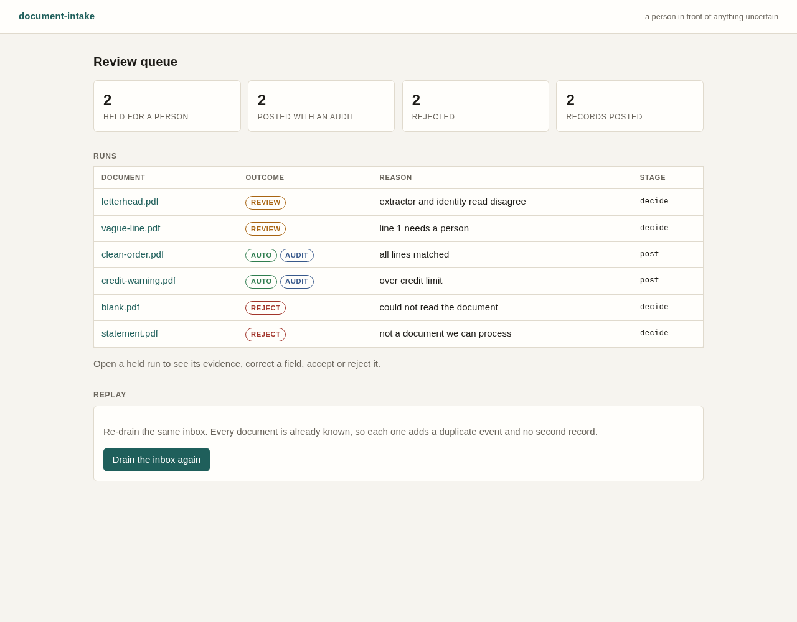
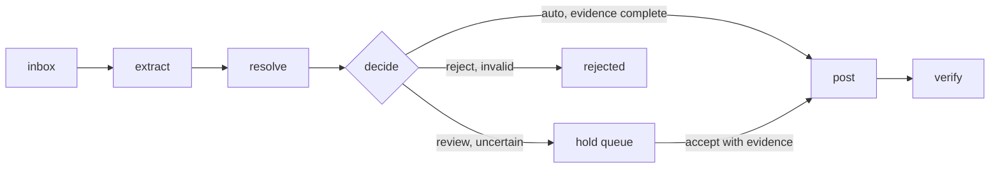
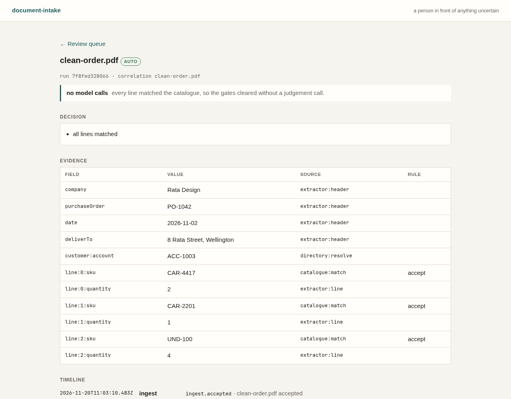

# document-intake

Takes a document from an inbox to a system of record, holds anything uncertain for a person, and
keeps an evidence trail for every field it posts.



The demo ingests six synthetic documents, sorts them into three decisions, and posts two of them
without asking anyone. The other two wait for a person. Nothing reaches the record store without a
decision, and no field reaches a record without evidence.

## Run it

```bash
npm ci        # the only step that needs the network
npm run demo  # builds, drains fixtures/documents, serves http://127.0.0.1:4321
```

Open `http://127.0.0.1:4321`. No key, no account, no cloud service.

To start from an empty state, `npm run demo -- --fresh`. State is JSON lines under `var/`, which is
gitignored. Override the location with `INTAKE_STATE_DIR`.

## The pipeline



Each stage writes an event with the correlation id. `var/events.jsonl` is the audit trail, and the
UI reads only that log. A stage that cannot prove a field refuses to post it.

## Three decisions

**Local first.** Every port has a local implementation, including the extractor. The demo runs with
no network, and swapping a port for Graph, Document Intelligence, an ERP or a CRM changes the
adapter, not the pipeline. The optional `Judge` is the only place a model may run, and it runs only
when a line is held.

**No evidence, no post.** A posted value must name the evidence that produced it. Corrections are
evidence too, recorded as `operator:correction`. Accepting a held run re-checks the gates and
records the person's decision; it does not bypass validity. An unreadable document stays rejected.

**Short-circuit by default.** When every line matches the catalogue, the gates clear without a
judgement call. The run detail says so in one line: *no model calls*. The interesting case is the
exception, not the default.



## What the fixtures prove

| Document | Decision | What it demonstrates |
|---|---|---|
| `clean-order.pdf` | auto | three lines matched, zero model calls |
| `credit-warning.pdf` | auto + warning | over the limit informs, it does not block |
| `vague-line.pdf` | review | a line in the hold band waits for a person |
| `letterhead.pdf` | review | the extractor and the identity read disagree |
| `statement.pdf` | reject | it is not an order |
| `blank.pdf` | reject | a scan with no text layer is unreadable |

Replay is a first-class action. Draining the same inbox again emits `ingest.duplicate` for every
document and posts no second record, including for held and rejected documents.

## Take it as a base

Four ports are the integration seams:

| Port | Demo | Replace with |
|---|---|---|
| `Inbox` | folder listing and watcher | Graph, IMAP |
| `Extractor` | template and positional reader | Document Intelligence, an LLM |
| `Catalogue` | JSON with exact reference and trigram matching | ERP product master |
| `SystemOfRecord` | JSONL append store | ERP posting API |

`docs/adapters.md` covers the contract of each port and what an adopter must preserve.

## Verify

```bash
npm run verify
```

`verify` re-reads the event log, takes every posted key, and compares it with the latest revision in
the record store. It reports `ok`, `missing` or `drift`. It compares against the local store: it
does not confirm that a remote system still holds the record. A successful post is not proof.

## Repository map

| Path | What lives there |
|---|---|
| `packages/core` | ports, stages, gates, matching, event log, projection, verification |
| `apps/demo` | folder and JSONL adapters, SvelteKit API and review UI |
| `fixtures` | six synthetic PDFs, a catalogue and a customer list |
| `docs/architecture.md` | how the pieces fit |
| `docs/adapters.md` | the integration seams |
| `docs/why-this-shape.md` | the reasoning behind the design |
| `docs/decisions` | four ADRs |

## Gates

```bash
npm run check   # lint, build, typecheck (svelte-check), tests
```

Tests are `node:test`; core tests compile first and run against `dist`. The demo tests spawn the
built server on their own port and exercise the HTTP surface.

## Licence

MIT. See `LICENSE`.
